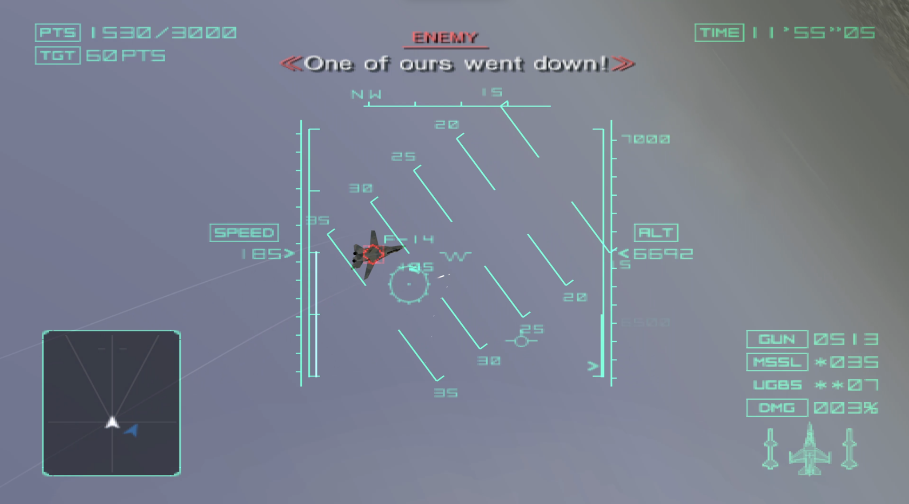

<div align="center">

# ProjectStonehenge

**A native x86_64 PC port of *Ace Combat 04: Shattered Skies***




</div>

---

## About

**ProjectStonehenge** is a native x86_64 PC port of *Ace Combat 04: Shattered Skies*, based on the North American release (NTSC-U, SLUS-20152).

The port is built from a decompilation of the original PS2 executable (ELF). It is **not** an emulator and **not** a static recompilation: the game code has been translated function by function into C++ (with AI assistance, see [AI Disclosure](#ai-disclosure)) and runs natively on PC. Game logic, physics, AI and mission rules behave exactly like the original, with PCSX2 running the original disc as the reference.

> [!IMPORTANT]
> Currently only the **North American release (NTSC-U, SLUS-20152)** is supported. Support for other regions and revisions might come later. The port checks the disc image at startup (SHA-1 `aaa707214aea7f8f9c2904c4b5e00c372c943533`, 3,554,705,408 bytes).

## Legal Notice

This repository **does not contain any game assets, files or copyrighted data** from *Ace Combat 04: Shattered Skies*. All assets, including the executable's own data tables, are loaded at runtime from a disc image that you must provide yourself.

To play, you need a dump of **your own legally purchased copy** of the game. This project does not support piracy in any form: please do not open issues asking for game files or links to ISOs, they will be closed.

This is an unofficial fan project and is **not affiliated with, endorsed by or sponsored by Bandai Namco Entertainment**. *Ace Combat* and all related names, logos and trademarks are the property of their respective owners.

## AI Disclosure

This project is being developed with extensive use of generative AI. The reverse-engineering notes, most of the code and the research tools in this repository were written by models from Anthropic, working under constant human supervision.

## Features

**Graphics and performance**
- **Unlocked frame rate** (frame cap 60 / 120 / 144 / 240 / 360 FPS): rendering is decoupled from game logic and interpolated, while physics and AI still run at the original 59.94 Hz
- **Higher internal resolution** with a multiplier from 1x to 8x (native 512×448 up to 4096×3584), including 4K output
- **Screen** windowed or borderless fullscreen
- **16:9 by default on wide monitors**: the game's own SCREEN RATIO option starts at 16:9
- **Anti-aliasing**: FXAA and SMAA support
- **V-Sync**
- **FSR 1 upscaled cutscenes**: the FMV movies are upscaled with AMD FidelityFX FSR 1 to match internal resolution
- **Dedicated in-game graphics settings**: a GRAPHICS in-game page under OPTIONS → SCREEN SETTINGS

**Controls**
- Keyboard and gamepad support through SDL3, with bindings in `settings.json`
- **Vibration** on gamepads with rumble, switched by the game's own VIBRATION option
- **Modern control types**: two extra CONTROL TYPE choices on CONTROLLER SETUP with L1/L2 and R1/R2 swapped (throttle on the triggers); the original types are still there

**Saves**
- **PCSX2-compatible save system** using PCSX2's folder memory card format, so saves can be moved between the port and the emulator in both directions

> [!WARNING]
> Save compatibility is still in **beta**. Always back up your original save before transferring it to the port.

**Preservation**
- **Built-in debugger** for testing (see [Debugger](#debugger))
- **Cut content and dead code preserved**: code that was unreachable in the final release (272 functions, including two unused scenes and the HDD support) has been ported along with the rest of the game. In the default build it stays unreachable exactly as on the PS2 but the debugger will be able to invoke some of it with the next releases (WIP).

## Roadmap

- [ ] VS mode (and a surprise 👀)
- [ ] Performance optimizations
- [ ] Modding support
- [ ] A full catalog and map of the cut content, and a debug menu to explore it
- [ ] Linux support

## 💻 Requirements

- Windows 10/11 (64-bit)
- GPU: any graphics card with **Vulkan 1.2** support and an up-to-date driver. Higher internal resolutions (4x–8x) need a correspondingly faster GPU
- A dump of your own copy of *Ace Combat 04: Shattered Skies* (NTSC-U SLUS-20152) as an `.iso` file (ISO 9660, 2048-byte sectors; raw `.bin`/`.cue` dumps are not supported)

## 📥 Download and Installation

1. Download the latest version from the [Releases page](https://github.com/Onaga00/ProjectStonehenge/releases).
2. Extract the archive to a folder of your choice. The port is a single executable: no installer, no other DLLs and no Visual C++ Redistributable needed.
3. Dump your own copy of the game to an ISO (for example with ImgBurn on PC, or by following PCSX2's [dumping guide](https://pcsx2.net/docs/setup/dumping/)).
4. Launch `ProjectStonehenge.exe`. On the first start the port asks for the disc image: click **Select ISO...** and pick your ISO. The path is saved in `settings.json`. You can also start the port with `ProjectStonehenge.exe --iso "C:\path\to\game.iso"`.
5. Play. Everything the port writes goes to `%LOCALAPPDATA%\ProjectStonehenge\`:
   - `settings.json`: port settings (graphics, input bindings, debug options)
   - `saves\`: the memory card (PCSX2 folder card format)
   - `logs\`: the log of the last session (attach it to bug reports)

### Command-line options (release builds)

| Option | Effect |
|---|---|
| `--iso <path>` | use this disc image instead of the one in `settings.json` |
| `--user-data <dir>` | use another folder instead of `%LOCALAPPDATA%\ProjectStonehenge\` |
| `--internal-scale <1-8>` | internal resolution for this session |
| `--antialiasing <off\|fxaa\|smaa>` | anti-aliasing for this session |
| `--fps-overlay` / `--no-fps-overlay` | show or hide the frame-rate counter |
| `--debug-overlay` / `--no-debug-overlay` | enable or disable the debugger for this session |
| `--verify-iso` | check the disc image again instead of using the cached result |
| `--version`, `--help` | show the version or the usage text |

Command-line values apply to the current session only and are never written to `settings.json`. Development builds accept many more options (start at a mission, input recording and replay, screenshots, RAM dumps, ...): see [`docs/port/command-line.md`](docs/port/command-line.md).

## 🔧 How to Build

The port builds with CMake and MSVC.

**Requirements**
- Windows 10/11 (64-bit)
- Visual Studio 2026 with the **Desktop development with C++** workload. It includes MSVC and CMake ≥ 3.24.
- Optional: Python 3, needed for `tools/check_notices.py` and for the research tools in `tools/`. You don't need it to build or play.

A Vulkan SDK is **not** needed: the Vulkan headers and loader (volk) are fetched, and the shaders are compiled with a fetched copy of glslang.

**Dependencies**

The command `cmake --preset windows` downloads every library listed under [Libraries](#libraries) from `cmake/Dependencies.cmake`. Each one is pinned to an exact version and checked against a SHA-256 checksum. The downloads go to `build\windows\_deps\`, and later configures reuse them. To download everything again, delete `build\windows\` and configure again. The licenses are listed in [`docs/decisions/dependencies.md`](docs/decisions/dependencies.md) and [`THIRD_PARTY_NOTICES.md`](THIRD_PARTY_NOTICES.md).

**Configure (once per clone)**

From a **Developer PowerShell for VS 2026**:

```powershell
git clone https://github.com/Onaga00/ProjectStonehenge.git
cd ProjectStonehenge
git config core.hooksPath tools/hooks   # enable the game-data pre-commit hook (see Contributing)
cmake --preset windows                  # generates the VS solution and downloads all dependencies
```

**Release build**

```powershell
cmake --build --preset release
ctest --preset release
```

Output: `build\windows\src\Release\ProjectStonehenge.exe`. No console window. The debugger is off by default, and only the release command-line options are accepted.

To make the release archive, run `cmake --build --preset release --target package_release`. It writes `out\release\ProjectStonehenge-<version>-win64.zip` with the executable, `LICENSE`, `THIRD_PARTY_NOTICES.md` and `README.md`, and nothing else. It packages only the Release configuration and stops if a file looks like game data.

**Development build**

```powershell
cmake --build --preset dev      # RelWithDebInfo: optimised, with debug symbols
ctest --preset dev
# or: cmake --build --preset debug ; ctest --preset debug   (unoptimised, for stepping through code)
```

Output: `build\windows\src\RelWithDebInfo\ProjectStonehenge.exe` (or `Debug\`). Development builds have:
- a console window;
- the debugger on by default;
- **F8** for native screenshots;
- Vulkan validation with `--vk-validation`;
- the development command-line options ([`docs/port/command-line.md`](docs/port/command-line.md)).

You can also open `build\windows\ProjectStonehenge.slnx` in Visual Studio and pick the configuration there.

## Debugger

The debugger is **disabled by default** in release builds. To enable it, open the configuration file `%LOCALAPPDATA%\ProjectStonehenge\settings.json` and set `overlay_enabled` to `true` in the `debug` section:

```json
"debug": {
  "overlay_enabled": true,
  "overlay_toggle": "\\"
}
```

Keep the rest of the file as it is: a file that is not valid JSON, or that contains an unknown key or value, is replaced with the defaults. You can also enable it for one session with `--debug-overlay`. Changes to the file apply while the port runs.

**Controls**
- **`\`** opens and closes the panels. Change it with `overlay_toggle`: another character, or a key name such as `"key:F12"`.
- While a panel has keyboard focus, the keyboard does not reach the game; gamepads still do.

**Panels** (read-only: they never change the game)
- **Performance**: frame rate and frame-time graph, simulation steps and dropped steps, renderer timings and texture statistics, and the frame-rate overlay checkbox.
- **Scene**: current scene and sub-state, frame counters, mission id, and the last 64 scene changes.
- **Memory**: a viewer for the PS2 memory (32 MB RAM and scratchpad) as bytes, u32 or f32, with jump to an address or symbol name.
- **Session log**: the last 400 log lines, with a filter.

A menu to enter the cut content is planned; see the [Roadmap](#roadmap) and [`docs/port/dead-code.md`](docs/port/dead-code.md).

## 🤝 Contributing

Feedback is very welcome! If you find a bug, or a feature that doesn't behave like the original game, please [open an issue](https://github.com/Onaga00/ProjectStonehenge/issues).

When reporting a bug, it helps to include:
- what happened and what you expected to happen (a screenshot from PCSX2 of the same moment helps a lot)
- the mission or menu where it occurred
- your system specs and the port version (`ProjectStonehenge.exe --version`)
- the log of that session (`%LOCALAPPDATA%\ProjectStonehenge\logs\`)

Pull requests and forks are welcome too. Project documentation (decompilation notes, data formats, architecture decisions, validation) starts at [`docs/README.md`](docs/README.md).

### Preparing a commit

> [!CAUTION]
> **Never upload game assets.** That includes the ISO and any file from the disc (`SLUS_201.52`, `*.IRX`, `IOPRP23.IMG`, `*.CDP`, `*.TBL`, `*.SMV`, `*.VPK`). It also includes PCSX2 save states (`*.p2s`, which contain game memory), RAM dumps, and anything extracted or converted from the game: textures, models, audio, video, archives and tables. The port reads all of this at runtime from the player's own disc, so the repository never needs it. Generated output belongs in `build\` or `out\`, which git ignores.

The pre-commit hook in `tools/hooks/pre-commit` enforces this. It is not active by default, so enable it once per clone:

```powershell
git config core.hooksPath tools/hooks
```

Before each commit, the hook checks every staged file and blocks the commit if a file:
- has a game-data name (`*.iso`, `*.cdp`, `*.tbl`, `*.smv`, `*.vpk`, `*.irx`, `*.img`, `*.p2s`, `SLUS_*`, in any case);
- is larger than 1 MiB;
- starts with the signature of a known game format (SMV movie, CDP container, TBL index, VAG audio, MPEG video, PS2 ELF/IRX, IOPRP image, TIM2/GIM/PS2I blocks).

A typical commit:

```powershell
cmake --build --preset dev ; ctest --preset dev    # build and tests pass
python tools/check_notices.py                      # only if you changed a dependency or third_party/
git status                                         # check that nothing from out\, build\ or the disc is listed
git add <files>
git commit -m "..."                                # the hook runs here
```

If the hook blocks the commit, it lists each file and the reason. Unstage those files with `git restore --staged <file>` and don't add them again. Never bypass the hook with `--no-verify`.

## 📜 License

The source code in this repository is licensed under the [GNU General Public License v3.0](LICENSE).

This license applies **only** to the code in this repository. It does not cover *Ace Combat 04: Shattered Skies* or any of its original assets, which remain the property of Bandai Namco Entertainment. Third-party libraries keep their own licenses: [`THIRD_PARTY_NOTICES.md`](THIRD_PARTY_NOTICES.md).

## 🙏 Credits

### Acknowledgements

These projects are used as tools or references. No code from them is copied into this repository (third-party code that is included is listed in `THIRD_PARTY_NOTICES.md`).

- **[Ghidra](https://github.com/NationalSecurityAgency/ghidra)**: the reverse-engineering framework used as the research database.
- **[ghidra-mcp](https://github.com/bethington/ghidra-mcp)** by bethington: the MCP server used to drive Ghidra during analysis.
- **[ghidra-emotionengine-reloaded](https://github.com/chaoticgd/ghidra-emotionengine-reloaded)** by chaoticgd: the Emotion Engine (R5900) processor plugin for Ghidra.
- **[PCSX2](https://github.com/PCSX2/pcsx2)**: debugger and behaviour reference for the original game; its source was read (not copied) to document the Folder Memory Card layout for save compatibility, the input-recording (`.p2m2`) format used to replay PCSX2 input in validation, and the IPU colour-conversion method that the port's movie decoding follows.
- **[ps2sdk](https://github.com/ps2dev/ps2sdk)**: syscall tables and SDK references used to identify library functions.

### Libraries

Fetched at build time, unmodified ([`docs/decisions/dependencies.md`](docs/decisions/dependencies.md)):
[SDL3](https://github.com/libsdl-org/SDL) ·
[Vulkan-Headers](https://github.com/KhronosGroup/Vulkan-Headers) ·
[volk](https://github.com/zeux/volk) ·
[VulkanMemoryAllocator](https://github.com/GPUOpen-LibrariesAndSDKs/VulkanMemoryAllocator) ·
[glslang](https://github.com/KhronosGroup/glslang) ·
[libmpeg2](https://libmpeg2.sourceforge.io/) ·
[nlohmann/json](https://github.com/nlohmann/json) ·
[Dear ImGui](https://github.com/ocornut/imgui) ·
[AMD FidelityFX FSR 1](https://github.com/GPUOpen-Effects/FidelityFX-FSR) ·
[SMAA](https://github.com/iryoku/smaa) ·
NVIDIA FXAA 3.11 ·
[doctest](https://github.com/doctest/doctest)
